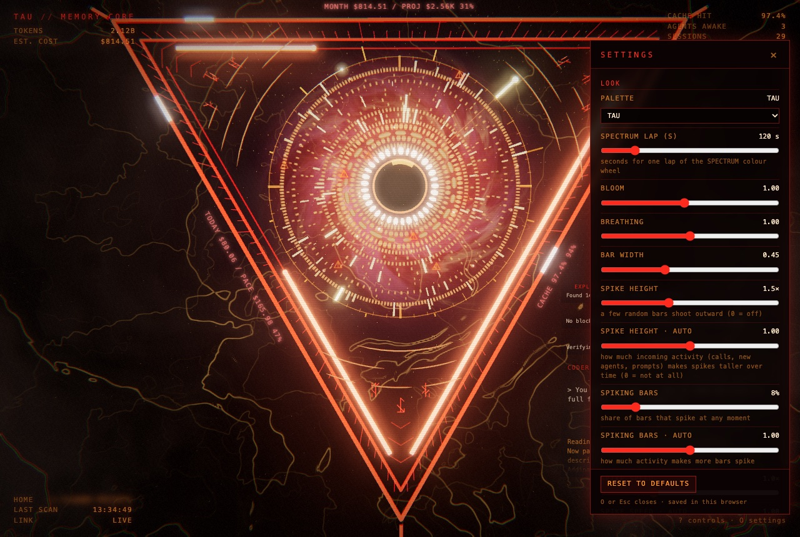
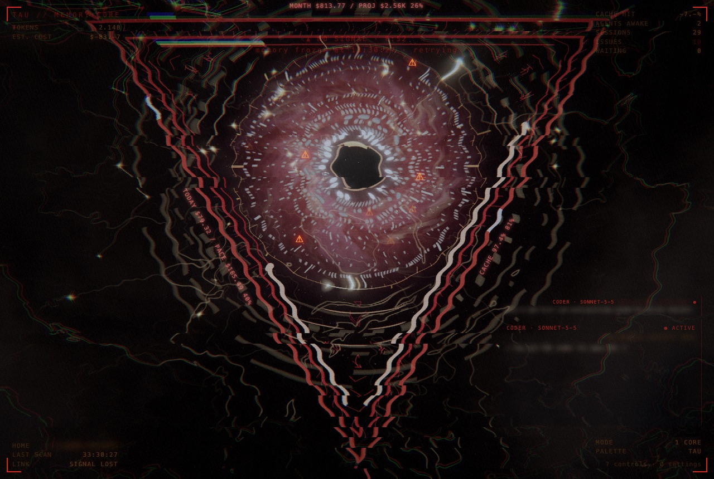
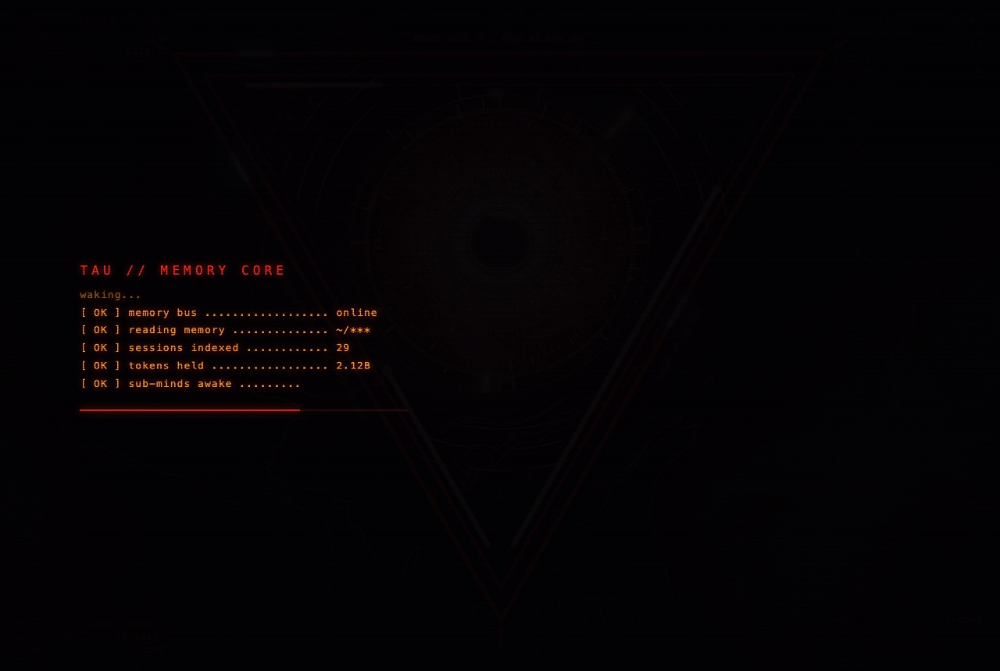
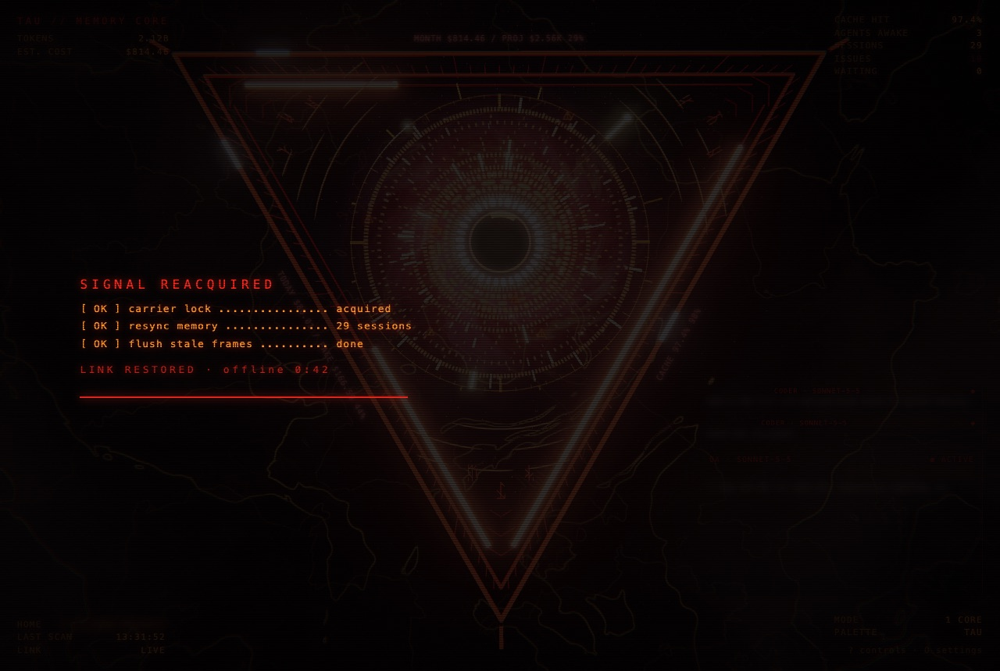
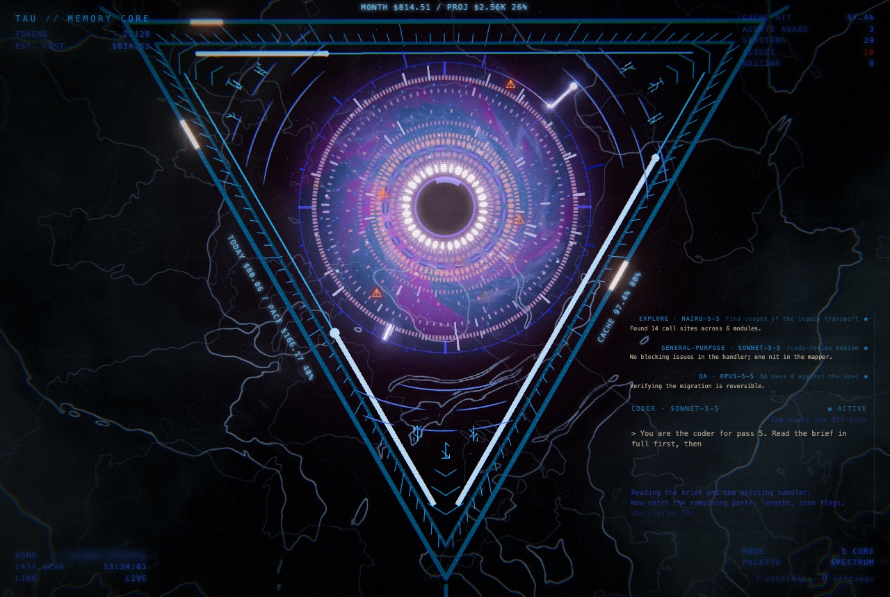

# Settings

There are three layers of configuration:

1. **Server** (`.env`): where the data comes from and how often it is rescanned.
2. **Tau 3D settings panel** (press `O`): look, motion and interface options, saved in your browser.
3. **URL parameters**: one-off overrides, handy for screenshots and shared links.

## Server (`.env`)

Copy `.env.example` to `.env` and restart (`npm run restart`). Everything is optional.

| Variable | Default | Meaning |
|---|---|---|
| `CLAUDE_HOME` | `~/.claude` | Claude Code data directory to read (e.g. `~/.claude-private`). |
| `HOST` | `127.0.0.1` | Interface to bind. Keep it on loopback: prompts and agent output are served unauthenticated. |
| `PORT` | `4477` | HTTP port. |
| `REFRESH_MS` | `5000` | Rescan interval. |
| `ACTIVE_WINDOW_MIN` | `10` | A session counts as active if its transcript changed within this many minutes. |
| `WAIT_IDLE_SEC` | `45` | Idle seconds before an outstanding tool call is flagged as a possible wait (only used for sessions without a status file). |

## The settings panel (Tau 3D)

Press **`O`** (or `,`) in the 3D view to open it; **`O`** or **`Esc`** closes it. Every change applies immediately and is saved in this browser (`localStorage`, key `tau3d.settings`). **Reset to defaults** restores every slider and turns HUD, voice line and feed back on; it leaves the palette alone.

### Look

| Setting | Range | Default | What it does |
|---|---|---|---|
| Palette | list | TAU | Colour scheme: TAU, ICE, VIOLET, NAVY, SPECTRUM (slowly fades through all colours, see below). `C` cycles it too. |
| Spectrum lap (s) | 20–600 | 120 | Seconds for one lap of the colour wheel in the SPECTRUM palette. |
| Bloom | 0.3–1.8 | 1.0 | Strength of the glow. |
| Breathing | 0–2 | 1.0 | How much the core and rings pulse slowly; 0 stops it. |
| Bar width | 0.15–1 | 0.45 | Width of the rectangular bars relative to their height (smaller = thinner, taller bars). |
| Blocks start at | 0–100 % | 30 % | Rings from this fraction (inner to outer) outward are drawn as rectangular bars instead of rounded segments. |
| Spike height | 0–4× | 1.5× | How far a spiking bar shoots outward, as a multiple of its own height. `0` turns spikes off. |
| Spike height · auto | 0–2 | 1.0 | How strongly incoming activity makes spikes taller (see below). |
| Spiking bars | 1–40 % | 8 % | Share of bars that spike at any moment. |
| Spiking bars · auto | 0–2 | 1.0 | How strongly activity makes more bars spike. |
| Spike speed | 0.2–3× | 1.0× | How fast spikes come and go. |
| Spike speed · auto | 0–2 | 1.0 | How strongly activity makes spikes faster. |

Spikes only affect the rectangular-bar rings. Only the bar's outer edge moves, so the ring itself does not shift; a spiking bar glows.

### Auto spike

Each spike setting has an *auto* partner so you can choose which dimension reacts to activity. Your manual value is the idle baseline and auto scales it on top:

- height × (1 + 2.5 · auto · A)
- share of bars × (1 + 2 · auto · A), capped at 60 %
- speed × (1 + 1.5 · auto · A)

`A` (0–1) is the activity level. It is fed by the recent activity the view already tracks (weighted 0.6) plus short bumps for each event: a batch of new API calls (+0.08 to +0.38), a newly started sub-agent (+0.35) and a new prompt (+0.25). Bumps decay over about 20 s. `A` itself rises with a ~6 s time constant and falls with ~25 s, so spikes build up gradually under sustained activity and relax afterwards. Agents that already exist when the page loads do not count as new. Set an auto slider to `0` to make that dimension ignore activity.

### Motion

| Setting | Range | Default | What it does |
|---|---|---|---|
| Motion speed | 0–1.5 | 1.0 | Global animation speed (rotation, breathing, spikes use their own clocks). |
| Signal-loss effect | 0–1.5 | 1.0 | Intensity of the glitch look when the link to the server drops. `0` removes the visuals (the banner and text stay). |
| Signal-loss speed | 0.3–3× | 1.0× | Scales how fast the glitches, flicker and scrambling run. |
| Signal-loss jitter | 0–1 | 0.8 | How irregular the timing is. `0` = steady, `1` = erratic bursts at random intervals. |
| Camera drift | 0–2 | 1.0 | Slow camera sway and mouse parallax. |
| Frame rate | 30 / 60 | 60 | Frame cap. It drops to 30 automatically when idle for 90 s, with reduced motion, or in signal-loss standby. |

### Interface

| Setting | Range | Default | What it does |
|---|---|---|---|
| HUD | on/off | on | The four corner readouts (`H` toggles). |
| Voice line | on/off | on | The typed line at the bottom (`V` toggles). |
| Terminal feed | on/off | on | The `tau://feed` window bottom-left (`L` toggles). |
| Agent box | on/off | on | Bottom-right box with the newest sub-agent's prompt. |
| Agent boxes (max) | 1–6 | 4 | How many agent boxes to show: the newest running agent is the big box, the next ones stack above it as smaller boxes with a smaller font. |
| Boot screen | on/off | on | Terminal-style start-up sequence on load, and a shorter see-through version when a lost link is restored. Any key skips it. |
| Privacy mode (P) | on/off | off | Blurs session titles, project names and paths, prompts, agent text, the feed, the session id and the home path. Shared with the dashboard. |
| Agent output text | on/off | on | The drifting output text inside the agent box. |
| Agent box opacity | 0.2–1 | 0.6 | How faded the agent box is. |
| Agent scroll speed | 0.3–3× | 1.0× | How fast the output text drifts upward. |

## Signal loss, in stages

When the server stops answering (the page re-checks within about 1.5 s of the event stream dropping):

| Link down for | What you see |
|---|---|
| < 3 s | Light glitch only, no banner. |
| 3–15 s | Ramps to full strength: tearing, RGB split, static, flicker, drained colour, frozen dashed rings, stutter, banner with corner brackets, scrambled HUD digits, corrupted voice line. |
| > 15 s | The scene dims into a low-power standby (30 fps). |

The effect strength scales with *Signal-loss effect*; timing follows *speed* and *jitter*. The clock keeps running because it is local time. On reconnect there is a warm flash. Preview it with `?demo=lost&lostfor=20`.

## Boot screen

On load the screen shows a short start-up sequence whose lines fill in with live data (memory location, session count, tokens held, awake agents). When a lost connection comes back, a shorter, see-through version plays ("SIGNAL REACQUIRED ... LINK RESTORED · offline m:ss") followed by a warm flash. Click or press any key to skip. Turn it off with *Boot screen*; `?boot=0` skips it once, `?boot=1` forces it, `?boot=relink` previews the reconnect version. Screenshot runs (`?shot=1`) skip it.

## Privacy mode

Press **`P`** (in either view) or use the *Privacy (P)* button on the dashboard. The blur covers: session titles and tables' Session / Project / Branch columns, prompts, agent descriptions and output text, the terminal feed, the session id and detail panels, tooltips, waiting-for-input callouts, voice lines that quote a title or a prompt, and the home path. Costs, tokens, counts, charts and the clock stay readable, so the view still works as a status display. The flag is stored under `claude-stats-privacy` and shared by the dashboard and the 3D layer. `?privacy=1` or `?privacy=0` overrides it. The copy buttons still copy the real id when clicked.

## SPECTRUM palette

The SPECTRUM palette drifts through the whole hue wheel (triangle, core, dial and background marble together). One lap takes *Spectrum lap (s)* seconds, 120 by default; `?spec=0..1` picks the starting hue.

## Other things that are remembered

Saved in `localStorage` under `tau3d.settings` together with the sliders: the **mode** (Core, Memory, Neural, Pulse, Models), the **palette**, **HUD** and **voice** on/off, and the Pulse mode's today/7-day window. The feed's on/off state is stored separately under `tau3d.feed`. The dashboard keeps its theme under `claude-stats-theme`.

To forget everything: clear the site data for the page, or run `localStorage.removeItem('tau3d.settings')` in the browser console.

## URL parameters

URL parameters win over saved settings and are not saved. Combine them with `&`.

| Parameter | Effect |
|---|---|
| `mode=1..5` | Start in that mode. |
| `pal=tau\|ice\|violet\|navy\|spectrum` (or `0..4`) | Start with that palette. |
| `spec=0..1` | Start position on the SPECTRUM colour wheel. |
| `w=7d` | Pulse mode shows 7 days instead of today. |
| `sel=N` | Select memory ring N (0-based). |
| `detail=1` | Open the detail panel. |
| `settings=1` / `help=1` | Open the settings panel / the help overlay. |
| `feed=0\|1` | Hide / show the terminal feed. |
| `zoom=N` | Camera zoom. |
| `act=0..1` | Force the activity level (also drives auto spike). |
| `demo=receive\|waiting\|issues\|agent\|agents\|lost` | Fake data for screenshots: a data burst, waiting sessions, issue rings, one or four streaming agent boxes, a dropped link (`lostfor=SECONDS` sets how long ago). |
| `phase=0..1`, `seed=N`, `pattern=shock\|sweep\|tendril\|cluster` | Freeze / reproduce a data burst. |
| `nosse=1` | Do not open the live event stream (polling only). |
| `shot=1` | Do not clamp the frame time and skip the boot screen (for slow headless captures). |
| `boot=0\|1\|relink` | Skip / force / preview the reconnect version of the boot screen. |
| `privacy=0\|1` | Turn privacy mode off / on for this load (and remember it). |

The dashboard accepts `?theme=auto|dark|light` and `#session/<id>` to open a session, and `#3d` to open the 3D layer.

## Keyboard

3D view: `1`–`5` / `Tab` mode, `←` `→` select ring, `Enter` details, `I` issues, `X` simulate a burst, `L` feed, `Space` freeze, `H` HUD, `V` voice, `C` palette, `O` settings, `P` privacy, `F` fullscreen, `R` refresh, `W` today/7 days (Pulse mode), `G` or `B` back to the dashboard, `?` help.
Dashboard: `G` opens the 3D view, `P` privacy mode, `Esc` closes the session drawer.
